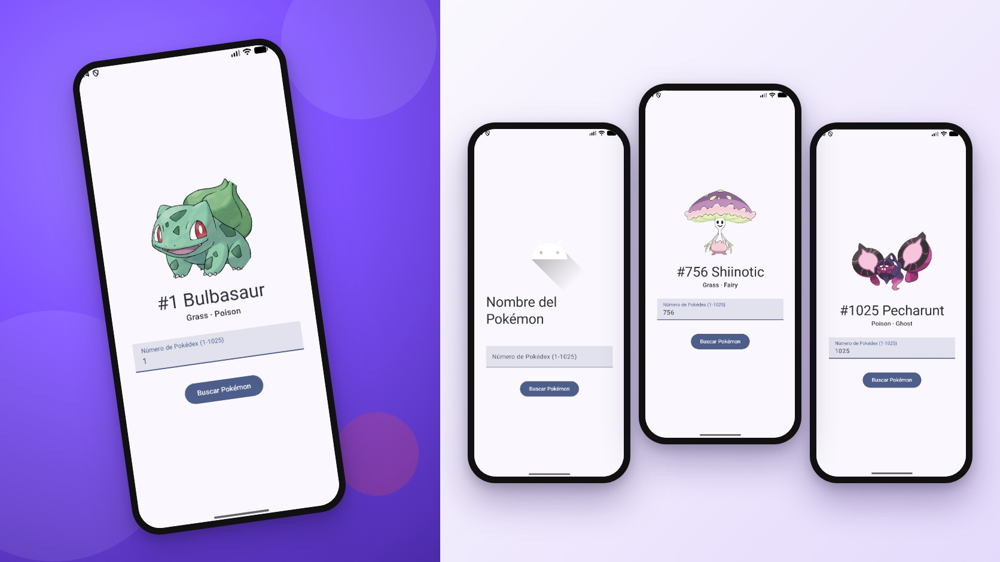
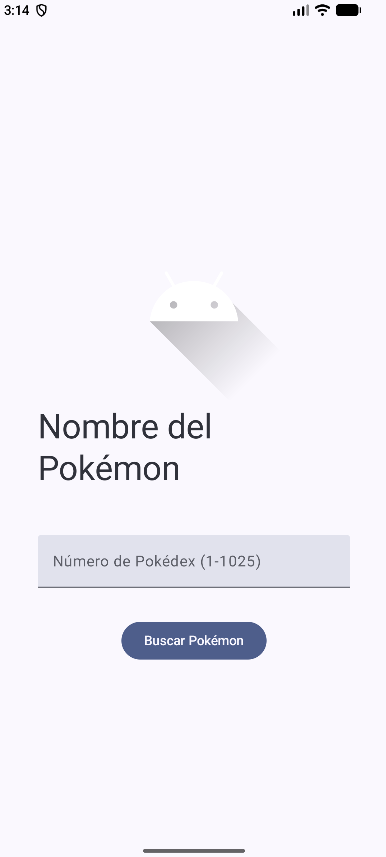
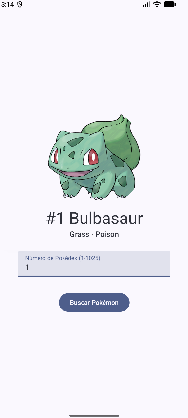
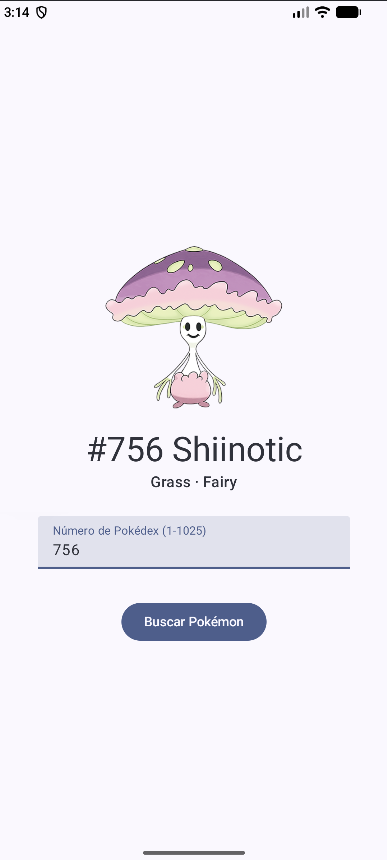
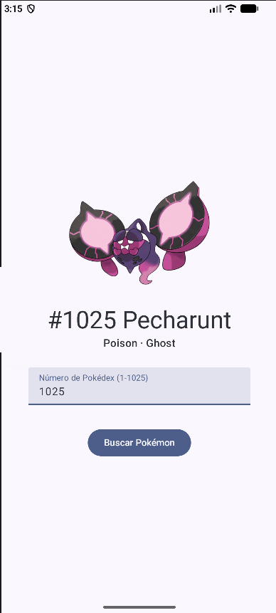
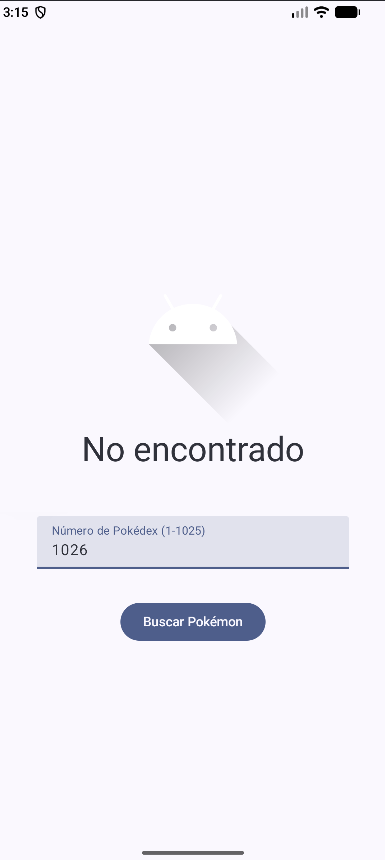

<div align="center">
  
</div>

<div align="center">
  <a href="https://github.com/evagr11/PokedexKotlin/releases/latest" target="_blank"></a>
  <a href="https://github.com/evagr11/PokedexKotlin" target="_blank"></a>
  <a href="https://evagr11.github.io/PokedexKotlin/kdoc/" target="_blank"></a>
  <a href="https://github.com/evagr11/Pokedex" target="_blank"></a>
  <a href="docs/Documentacion_PokedexKotlin.pdf" target="_blank"></a>
  <a href="https://evagr11.github.io/Curriculum/proyectos/pokedex-kotlin.html" target="_blank"></a>
</div>

<div align="center">
  <a href="https://git.io/typing-svg"></a>
</div>

<div align="center">
  
</div>

# Sobre el Proyecto

**Pokédex Kotlin** es un buscador de Pokémon para Android hecho con **Kotlin y Jetpack Compose**. Escribes el número de la Pokédex, pulsas *Buscar* y la app consulta la [PokéAPI](https://pokeapi.co/) para mostrar su ilustración oficial, su nombre y sus tipos.

Es la versión en Kotlin y Compose de mi [Pokédex en Java](https://github.com/evagr11/Pokedex), hecha con vistas XML y `RecyclerView`. Tenerlas juntas permite comparar cómo se resuelve lo mismo con interfaz declarativa y con el sistema clásico de vistas.

**Características principales:**

*   **Búsqueda por número:** Cualquier Pokémon de la 1 a la 1025, con una sola petición a `pokeapi.co/api/v2/pokemon/{número}`.
*   **Ilustración oficial:** La imagen se descarga y se guarda en caché con **Coil** (`AsyncImage`), con imagen de reserva mientras carga o si falla.
*   **Tipos del Pokémon:** Se muestran debajo del nombre (por ejemplo, *Grass · Poison*).
*   **Estados de la búsqueda:** El botón se desactiva y muestra "Buscando..." mientras llega la respuesta, y avisa si el número no es válido o el Pokémon no existe.
*   **Teclado numérico:** El campo de texto abre directamente el teclado de números.

### Galería

| Inicio | Bulbasaur (#1) | Shiinotic (#756) | Pecharunt (#1025) | No encontrado |
| :----: | :------------: | :--------------: | :---------------: | :-----------: |
|  |  |  |  |  |
| *Antes de buscar.* | *El primero.* | *Uno cualquiera.* | *El último.* | *Fuera de rango.* |

# Contexto del Proyecto

Proyecto del ciclo de **Desarrollo de Aplicaciones Multiplataforma (DAM)** para practicar **Jetpack Compose**: funciones `@Composable`, estado con `remember` y `mutableStateOf`, componentes de Material 3 y llamadas a una API REST desde una interfaz declarativa.

# Stack Tecnológico

<div align="center">
  
  
  
  
  
  
</div>

<br>

<div align="center">

| Componente | Tecnología |
| :--------- | :--------- |
| **Lenguaje** | `Kotlin` |
| **Interfaz** | `Jetpack Compose` con `Material 3` |
| **Red** | `Volley` |
| **Imágenes** | `Coil` (`AsyncImage`) |
| **API externa** | `PokéAPI v2` |
| **Plataforma** | `Android` (minSdk 24 · targetSdk 36) |
| **Documentación** | `LaTeX` |

</div>

# Estructura del Proyecto

```bash
PokedexKotlin/
└── app/src/main/
    ├── java/com/example/pokedexkotlin/
    │   ├── Buscador.kt      # Activity y pantalla en Compose: imagen, nombre, tipos, campo y botón
    │   ├── API.kt           # Petición a la PokéAPI con Volley
    │   ├── Pokemon.kt       # Nombre, número, imagen y tipos
    │   └── ui/theme/        # Colores, tipografía y tema de Compose
    ├── res/                 # Iconos, textos y temas
    └── AndroidManifest.xml  # Permiso de internet
docs/
├── Documentacion_PokedexKotlin.pdf  # Documentación técnica en LaTeX
└── kdoc/                            # KDoc generado con Dokka (GitHub Pages)
.github/readme/                      # Mockup y capturas de este README
```

# Cómo Utilizar el Proyecto

### Instalar la APK

La forma más rápida de probar la app es instalar la APK de la última versión, en [Releases](https://github.com/evagr11/PokedexKotlin/releases/latest):

1.  Descarga el archivo `.apk` desde el móvil.
2.  Ábrelo y, si Android lo pide, permite **instalar aplicaciones de orígenes desconocidos**.
3.  Pulsa **Instalar** y abre **Pokédex Kotlin**.

> Necesita **Android 7.0 (API 24)** o superior y **conexión a internet**, porque los datos llegan de la PokéAPI.

### Compilar desde el código

Para ejecutarlo necesitas **Android Studio** y conexión a internet.

1.  **Clona el repositorio:**
    ```bash
    git clone https://github.com/evagr11/PokedexKotlin.git
    ```
2.  **Abre el proyecto en Android Studio:** `File` > `Open` y selecciona la carpeta `PokedexKotlin`.
3.  **Sincroniza Gradle** y ejecuta la app en un emulador o en un móvil con `Run 'app'`.
4.  Escribe un número (por ejemplo `25`) y pulsa **Buscar Pokémon**.

<br>

<div align="center">
  <p>Creado por <strong>Eva Gallardo</strong></p>
  <a href="https://github.com/evagr11" target="_blank">
    
  </a>
  <a href="https://www.linkedin.com/in/eva-gallardo-romero-830362349/" target="_blank">
    
  </a>
</div>

<div align="center">
  
</div>
